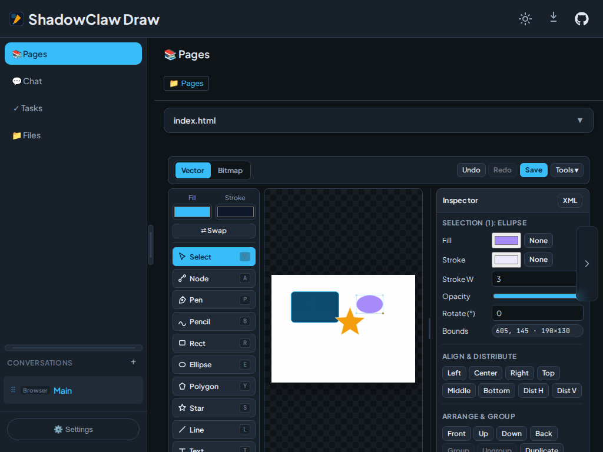

# [ShadowClaw Draw](https://xt-ml.github.io/shadow-claw-draw/)

[](https://github.com/xt-ml/shadow-claw)
[](https://github.com/xt-ml/shadow-claw-draw)
[](https://deepwiki.com/xt-ml/shadow-claw-draw)

**[ShadowClaw Draw](https://xt-ml.github.io/shadow-claw-draw/)** is a dual-page, mobile-first, accessible **Vector (SVG)** and **Bitmap (Canvas 2D)** graphical studio built with plain Vanilla ESM JavaScript, Web Components (`scdraw-*`), TC39 Signals, OPFS workspace storage, and 26 declarative WebMCP tools (`scdraw_*`), powered by [ShadowClaw](https://github.com/xt-ml/shadow-claw).

[](https://xt-ml.github.io/shadow-claw-draw/)

## Two Studios, One Shared Engine

1. **Vector Studio (`/main/`)** — `<scdraw-vector-workbench>`:
   - Inkscape-inspired live SVG DOM canvas with 13 tools (`Select`, `Node`, `Pen`, `Pencil`, `Rect`, `Ellipse`, `Polygon`, `Star`, `Line`, `Text`, `Picker`, `Pan`, `Zoom`), `Fill`/`Stroke` color pickers, and color swap (`X`).
   - Direct Bezier node/handle editing, RDP freehand smoothing, geometric primitives, `Align & Distribute`, `Arrange & Group`, layer visibility/locking/opacity/blend modes, and a live SVG `XML` inspector/editor.
2. **Bitmap Studio (`/main/bitmap/`)** — `<scdraw-bitmap-workbench>`:
   - GIMP-inspired multi-layer pixel canvas with 8 tools (`Brush`, `Pencil`, `Eraser`, `Fill`, `Select`, `Picker`, `Move`, `Pan`), 8 blend modes (`normal`, `multiply`, `screen`, `overlay`, `darken`, `lighten`, `difference`, `add`), local image import (`Open Image` + drag-and-drop), and PNG export.
   - **Document-Space Offset Layers**: Painting, erasing, and flood-filling operate directly under your finger/cursor even after shifting layers with `Move`, automatically expanding layer buffers non-destructively (up to `4096×4096`) without discarding off-canvas pixels.
   - **Selection Masking & Clipboard**: Rectangular marquee & inverted selections restrict strokes, fills, levels/desaturation, clears, and crops; includes a mobile-first Selection & Clipboard action bar (`Select All`, `Invert Sel`, `Cut`, `Copy`, `Paste`, `Fill Sel`, `Clear`, `Crop`, `Deselect`), `Copy Visible` (`Ctrl/Cmd+Shift+C`), and `Paste` into a new positioned layer (`Ctrl/Cmd+V`) or into the active layer (`Ctrl/Cmd+Shift+V`).
   - **Real-Time Filter Pipeline**: 10-group Canvas 2D filter panel (`Blur`, `Brightness`, `Contrast`, `Saturation`, `Grayscale`, `Hue Rotate`, `Invert`, `Opacity`, `Sepia`, and `Drop Shadow` X/Y/Blur/Color) ported from `<x-canvas-image-manipulation>`, alongside `Crop Selection`, `Flip H`, `Flip V`, `Rotate 90°`, `Desaturate`, `Invert`, and `Reset All`.
3. **Mobile-First Ergonomics & Full Screen Mode**:
   - Adaptive `@container` grid with horizontal thumb toolstrips and panel tabs (`Canvas`, `Layers`, `Inspector`/`Filters`, `SVG XML`) on phones, collapsible `Tools ▾` drawer, `44px` coarse touch targets, `installPageSwipeGuard` (`data-no-swipe` / `data-no-nav`), and a **Full Screen** button on both studios using the Fullscreen API with `100dvw × 100dvh` fixed-overlay fallback.
4. **Cross-Studio Bridge & OPFS Storage**:
   - Both studios share `globalThis.__scdraw`, OPFS persistence (`.svg`, `.png`, `.scdraw.json`), and bidirectional conversion (`scdraw_rasterize_vector_to_bitmap` / `scdraw_embed_bitmap_in_vector`).

## Documentation Pages

- [Architecture & Declarative WebMCP Tools](pages/main/~/content/02-architecture-and-tools.md) — Web Components (`scdraw-*`), all 26 `scdraw_*` tools, IPC channels, and extending guide
- [Vector Studio Tools & Pen Editing](pages/main/~/content/03-vector-studio-tools.md) — Vector tools, Bezier nodes, Inspector, shortcuts, and XML workflow
- [Bitmap Studio Tools & Pixel Painting](pages/main/~/content/04-bitmap-studio-tools.md) — Painting tools, moved-layer coordinates, selections/clipboard, filters, and transforms
- [Porting & Upstream Attribution](pages/main/~/content/05-porting-and-attribution.md) — Inkscape, GIMP, `<x-canvas-image-manipulation>`, and `shadow-claw-daw` provenance
- [Agent Guide (AGENTS.md)](AGENTS.md) — Architecture rules, namespace checks, and developer guardrails

## Development & Verification

```bash
npm test             # Run all node:test unit, engine, page, and a11y suites
npm run check        # Verify scdraw_* / scdraw-* namespace isolation & tool manifests
npm run build:tools  # Regenerate .agents/tools/scdraw_*.json & metadata from bin/tool-manifest.mjs
npm run skills:index # Regenerate .well-known/agent-skills/index.json
npm run dev          # Preview locally with ShadowClaw
npm run build        # Production static build to dist/public/
```

## License

AGPLv3.

## [Porting & Upstream Attribution](pages/main/~/content/05-porting-and-attribution.md)
