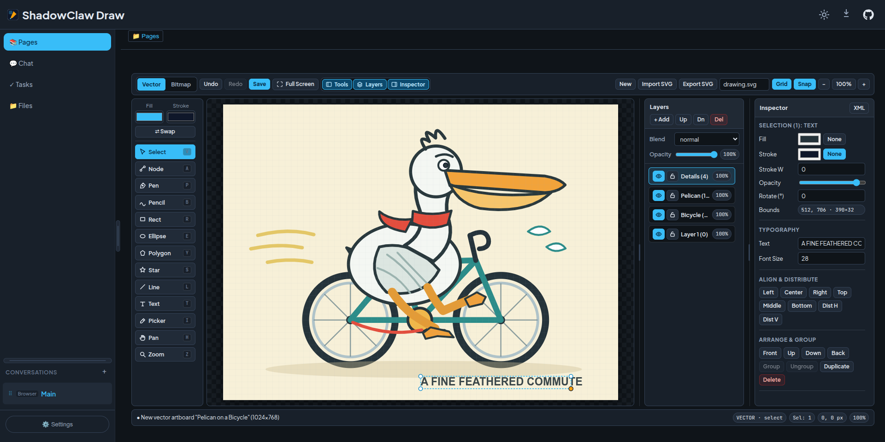

# [ShadowClaw Draw](https://xt-ml.github.io/shadow-claw-draw/)

[](https://github.com/xt-ml/shadow-claw)
[](https://github.com/xt-ml/shadow-claw-draw)
[](https://deepwiki.com/xt-ml/shadow-claw-draw)

**[ShadowClaw Draw](https://xt-ml.github.io/shadow-claw-draw/)** is a three-studio, mobile-first, accessible **Vector (SVG)**, **Bitmap (Canvas 2D)**, and **Animation** graphical studio built with plain Vanilla ESM JavaScript, 15 Web Components (`scdraw-*`), TC39 Signals, OPFS workspace storage, and 36 declarative WebMCP tools (`scdraw_*`), powered by [ShadowClaw](https://github.com/xt-ml/shadow-claw).

[](https://xt-ml.github.io/shadow-claw-draw/main/animation/#file=7d3pj-s4dijw7--vIDxA8AJMqbmTej01QPftvpkA3ZP0LAiQLweyLe_7bv_1D4dabJdl2dbYkquvg2TmmuWq6BxRFEmRP_1pvmqTzXAwmr_XOovF5P999916vfbWwhvP2t9xSul381W7Rtbd5qLzXmOUyxrphN12Z_FeM9rWyKobrn8cb95rlFCCPyeuuBksgrd5J2iO12-NQbB-a86C9Vsw6g6DRXc8eq8tZssw-VrD_XAUDMP32j9Hi-5iEDbJD8l3j7_Vmszfa4x_KJwFw_CtGQ6C7fy9ZsUfj__3-MuD8Xjy1hgvR4v3Gs340XDcDN9r-M_jH9bb77U_tNz_1P78fwj50yxsLI6_ETT67dl4OWom8W3c_4ut-8_zOWx1B4P93ybfub_ePo3w5HhdxBhwjTS784n70B0NuqPQHSEhf4oyHpJgsZh168tF-Ff3d-Jv10g9bHdH7zU6r5FVMFiG8-QPfD8a5_xHjfTD7T-6Q_w-_Z56TGvzPfWEEOJ76qnvqaejEoslrEYawaDxq0tssztvzMIFnvzl7L1GPenbeY3MwkkYLL5Ep6U7aoat7qiL34qS05qF4S6Mc-Oy022-1wbBNpwB-3ASsfC99h_uRCR5CAeD7mQeut8KBzBcb60JlzPYwXY4bsR_IKqB0S-SqPKmJ-fLTz_-7MsamS9m4374XouyEH16i08tTQswg41g8l6LDuKwuDfGhMfl40nQ6C6wfnjC1khj815TnNZIY_te09bWyGzzXpOM1shs-17jfJ-A79oZmYjC2rSBUQjriyAzMV-DGfklbJN_C4aT78l_h81gkGQJj-8oRS0-Bsagux7sjnKEf6MxC0Z9EsyGSY4OU_Je-wNXQogfPubIvzlHG_ZeU5iCLf5D0xrZ8PeaNMLTNbLl7zUl_H1eJsGicxyCosA47HqbxkkIg7BNxsuFu2DOBOELK758DILbm6Novtd-JdJKIo0mvxFlmceJ4sbjRGrjaaLwj56PwjSBCQj0ODOKM0f_xTc_Y6U5Pnr26KM_rUb-BJgEf7vrnxz9xFXAx1chqZSrMCyuMK4S-ezKStToAVPQaKzNSQDrsF4Pm6Q1Hi_S1uInbf19JTlbj1TBE6GsS7_wBPkFT4kn3CcfP_m-J4kS1JPkF6Ko9hRRQkfftMJ9Up7FT4rhiRPGU_hJWvw97nua_O_FZmY-4oO1BQY2oDqzlfmx29g2Bul9qNGdNQYHlWI-Ep3JHDRon3WOUvqP7uzsxZhZHQpUZ2xnhYjbWdekzN5rjOl93FnHO7VgoDPe2KPj_Vv3XAP4w9cv4ov_8XDNfY7W1-euN3eoQ7AwNHZ6dKh_n4z753JrmLX2548HK_6VO5qNLjx36MdtN_aA3EWHJeejmAnwIej07FNGIXztSey-YSSaxx9yollDAMP2PHjOaFwJRqJkXhTzIdRBr8f0KaPgWnhK8KvPycKHBnQa4kmjEfqq62SxhCYIZWbPGcXhOZF-_OF8NEsfQlhJ2XzKaNLrROrcFnjZhxYsGrPxc0Zx2HadnJOsm99KQBs24_ZxPH9Z1tM-z89C_iR-uni7ljcHlH3_u3C4Q-hAe2ppJX0Lw2_tW6w1dGGzZOsK-hYnR5vft1j3oAdWmxvvyiej5XvUbHfoRzXbUu1ZqeJ201eeb3Jbm_UK-tDjRjxlNEbFAbj7mYxDOx_NpgkD6LZxOucJo9FWepTb66PZwBCWKz56zmiE8Ji6vqZtBzCCJm_e2P-rJBoen6jz0ewEjEHtJjf2nKqoaThV5ELLiWYLE-Cq-ZzRHLUCl6Pp0hCmUMfR9zNGc9xCf6xpGTfHLl3ADHr9aeds3yMUsimaBwG523lwn77H6f3xYKZoPNiengCmYA60vmPHd_MwmJHFrBuM2oOz3ZAv9os9ua-z2yeKJuPuaDF3Hac_Kk2JVOqPklGiWPQ5Lr8YSR8WMG3tji-Mr7PxaEHcM4my4kiOX-N_U0UMj-JI4onL8y4LzmEJbLP4cHMMgwWZjOeL2zqGt18b8SRkdDW4OX03FyLiVkpodW4C0h18D1Ywtfa4g_j3oNnc16U_aCV-4D9cPHhdcNqRUiI0Jb_hZCERkhO1L_EFEcYQKfG_3fQi5UQYdTiZeHpKhIA12LHSx9VrPOuT-SK87clCwVOi01OCtcfdPGQ8xBOS5p0SMYANrJur467jX4JRcxDWg9ltB8-LnRMtKRESz4C2lAhOibaWCOVKfDwDgmgt8Uzkt7FSwBaG7fZxG_vFPeNph_to_vCV_mjk5TpWbCjinvMcNrWC5Z0BNcOnU80OP74qvnSC7oi0l8GseeYkHI9Vk2Mu-FxECE2UxucikiuiqSKKKaLs2VEUPlAYzoFpaIad7ZmEkznerwm7qRrdfoPLfrqmBPeSOzQOjc7HMdHADPiLvsqPg1cSh7TmyjhmG2AWZh3Zzo9DVHM-GE0eUx3MzuY8nNkw4MD8cVK7jh_O_Hc46DaCUe3shaW7-Mw0XNjjtu0fQXdAWmGw6ISz-b5FYF_VV3aYi8yHXbe3CPFdR7n_-8W1bsJw_JfWREp8wCUEJVJqd79RRBp7eL85eeiPoRmBD1IXze5x5yxOCamPm9t9ZPKr-SouRlZskkiauK2T2C3CB_0Me8X4oJ_R3L6A7bu2o0VXRyH8Mh61yShs9G89_tsfqEZnxuDd3-DzYK6IENjuUcKNcv0BSjhXRFFFmJXuO5QwQYkyijDp4_2JK8K0Jsq3hDOB39GWcGmw7SSC4m9pyojQgiiJteDo7GbdxXyKrVGwaXSP78lh0CznpCrFo5PKjHQ3sMNZ4tMz6Q-w1dmO5_zkeEljFp7vlN7pkN15xLPHmHuuT5nnE2PwGTHxXQmTnk-UJEoxYt25lr7nE2ndibRn1yxgdIEE5sN81T5-DPljGPTJcjIJDzoV_IeD1vPeTYircoaRX4gVWB0xMGsEYb4g1hrCqe9KsMoa9x3O8Vm6slgx2WGlywhyDCyA9dwfnAY5GS8bnX2Q-ovSPz4sSDxYal2_jxIuLbGKukB-IwZLrCZaa8KN6xvilapM-lsXrqu6BVaHNpscX1c_b_djj6_ufy5Gd_sI0F1WJrmslI0m1OWFA94Aa8B4M1wet_LLSTddbPLhCN9rf6AtZvjJrMHtXfPokM3xIec2BI0RsCb0m6z-McH12X4V2lWtQMHRnVKcMIFttzKaMC6J8hVhIvewWxJYFzZyLI-HpY1g1sp5MHTP45Y-J9xELZMi3OdEuRLtLmBOBOP4M6GivoJPiaAm_5JuDYH1gIeT3mlUZBEc1KBHh0YJ9_GSliK6IUrqE659j2EZlUQwbLClEUQIdsW6na01beljq8x2xmT2Df8a3rA-sG1X2PoNgsXmKFXuj1S7QFBJ7SXLTCw731pgFHUfm7dBsGIZnf9gMwhJI5jc-qDz9umIzBHw2esPD7w5w2au12kEp-kvfXGjlkRad7FJievMGPMMURJXoilzdiYFw2hPsfVbm3onM4yzg3j_R2E-Hn7h1Y3XHv7pRdATwELoD_rj08Mva3mj4tZVdxZXd3cJaJl5CZyegMEMWAsGE5-fRpC1vvEr_YEd3Tnvur5RCZd6LT2Djbj03SftYQ9OGY6rFo1wqxaVcasdjR99U7nVjgZXR_5C8NGCdJ_cN7lb7Wiop65sJ0c7YG1ocd_PG0OT_-mO2tkDafwj8z6wDtj-pHWUWPdL6WLRLz_rnx86fhaGxmMynBl0jwMEjcdkOEKTHOs-3mhwfC2FTX_r7H0Sg1sZvPsvt9v-SXDJLAHBg5qfqf_-jz-KH77eqdLg3JvwXZyGEomRMelmBHDBLCfCRuNS5WJX2BfQmkSz2vi7v-GCWCIlJ9IqzNV18yxLENBcb1RmHfkpxN7C_Ow8S2cSgAK67h4P5P8-CcNmbuZ-5l-EukPLcfC8zo_z6Nt4QpkZ66ZcOE7pC0yjiWb0fyNMKjfvz10t4eRXwqgh-HjmN8K0IQJH9JwT95TjfD-rzYD1IdgNj8eHv45x20_GPNPJCCPzIVPB-mMwcEHJlAhJ3rgmyhL89CYYYZa8uY-_Eiuse9AxJYKTN3f9EIlf4z5hirwpSt4OxiaLcLM4vGhajdkMZAPEfHV8s_gSTFzUFH7Yj0-O7g8P2HPiux1KgjPPuF1KBldZtcajxVsrGHYH2_faPBjN3-bhrNuKfzDv7sKoj-A-ruN9TJrSGsFg34JRozOevdeGXfdo6s8__Ok7LD-bjzUF2YTePFCZ-WDwtdR8LGbBaN4az4b480WwCP-v8DQRUniGGC498-9RzrAgzhnHm-yds_Y1P2tN2gQZwmq1qWdmjcN_Vp41ToSSLmvKU3HWsCDOmvD43bP2nxeyJucgW2DEupWZNQF_rThrbxQrm_ZdVWNx0rQfp4x59u4p--uFlPkGZBtsfzPPTJmEn6tOmfAsEdZ6lhjO0pqGBVHauP-AmvbzhbQ15yA7sLMfJsyStKnKW7U37lm8P2PamO_JKG2uIE6b8VjpzVp3ALILstsJMtOmK69tuO9NchxmYNZEnDUsSLJWelUbaZA9mA9X2bcCU3KH4jRn0q0KwYszyZcUyaVZdnejOZuC7MPchp3MbFn4R8XZ4p4gUvmuOROeH2cMC9K7gL571v5xIWvrFcgBDHlHZGbNh79U3ZwxbM6MjfsbSXOGBWl_4_7N2V_y0xbyEOQQ_I7OvnkyWnl79iaJ9HEDL3Y4ksqGBWnf9v6V7UKDFgYW5Aj60yXNzhqDv1WdNaxt-GiUE8N50udwBck46gF9jr9dyFtrAnIMk2l7k503Xnlt425rMsPFm0nvVuEKr7i_cf_e7aWqNmiBnIBcNtrZKRPwU-XjKJ8ohZPQ2OFIkoYFcdr0A9L204W0TQOQU6Bds8pOm4QvT9BPUwa3tmNdi_sdriBO2_2T9uVC0jZ9kDPYSt9kJ03Bf1XdrOGYQFPqbqI8uR24grRZu__t4L_y89biO5Bz2Gz9YXbeNPxadd5wCKp5dDuIbwbuY3oTvf-o4NcLWbMByAVQ34bZWTPVZw3nOrS0HnNdtvgadQVJl630rDU7IJcwCqTNzpqFf1Z-PxBEG-aSJjwdJw0L0uHB_dP2zwtp605ArqA5VM3stPmVj6rwcaG2-LAQ7wdJy4YFyf2g_FFVayxBrmHX2Z2ZxC17eIB7nahKahLX3v2H58cdsujBWvJfmeLZB9wrSzxzqSjunTnU7AJ69rvwzjqNCa5rCvrb4w21nx0867T6-Byxs-396-BZZ9ACNgDbCo_vm9WDZ_stACwPCuuMA2BDCIb15UkA1XFnmuJtXmq3doNKoqjJi2FWBzaC_qjfzoqhZOws99hPK9DKBzaGaWPKT469NOoMl_G4yoPRu8qT7IW-UHm2EtgE-GTWOjn4CpgzXyJsRnm0uIfx-JNbmi2UOx02-iSxFOdf3KpP5h98wi1A-Mm4f0v3W7iA8oWcfaPI2UO2uWcgZ-w2iKQgdlZSNELfBpEUxM5Kiob7t0EkBdGzsqKRt0EkBdGzSqK5DJEUxM-qqGlXQCQF8bMqWoFroimGoFXSQl8BkVyBoD0UInkhaJ8dQXsI75dB7LDrgNWC-FlJURh7G7BaED8rKxp-HbBaED0rKQqtbgNWC6JnZUXDrwNWC2JnVZyTK4DVgthZ2ddJPrBaFDmrou26Bli9Ajl7KLD6Qs5eyNlJJC_k7IWcvZCzF3JWEDnrNlvApjCj4fBMwqtFztInavlRtANgM9iM1Do_iuqJM5n3ZKrb6wObw3I8H-THURFxdkDOHcbxTSJnKkXOonf1RMyZ_2LOXszZizm7A3MmPyBn5pg4U_yzAWfcU5Iwwz1qHHPGPW0Jw11DzNFmzOOMMI0LfK3VniXMGM-pB_gzYwnztYccmjAeQxKMe8o6Qcn3tCKc4bqlTwehWeFJSbhmmAaLrIsgXCuP41k3xoUqmPCEIlppTzPCLY3SonGhgSFc-ZiIF5P2YtJeTNrnYNKY2wpIDYbruZs0NmZEMOvp26i07nYGbAHjzejjK4QLUGk9uQa2hDXrHPfInoFKSwZCmuZMUmIMZghsBdQMbcYQ4omhtF7QA7YG3VrsTpNfIZTG3btTBYsWFvp5RlevuQW2gVXdDjNDKBtJO3_op1W_w4BtYbHYNk8PvfRFka6SHy2KPKr2p4nvjYDtwMyn4enRl4-jSV8hh2ZV9IJXJtwnE-Fo7kWvuATIfcKVNDi0iL6Jey6Jcq-HxZWQNvrk_q2QTfOp51_XLvaGc-AU2ks7yht559NovfkWOINus31cn0un0bjHUxwN_x3xaFFpBKS51xwjkeZTV-qQNIn_3v-FPCittxbAOTTUrHsSalVQWhy1o9Jc1IilYec35dJMnBcVZyMi02z0DYemxd9wbBpufovgNO5dXrX_O6XTaEqnRdPU3HWnkE6LZqfxR8K4pwnMNwmdxkVCp1kR0WnCfjI6TeL8sMcu42m4cU04vLEooNZmK5AbGLTbx29CrwpQy95rhqaacPsaE8WJu4158X7Q--8-vuCetE0AcgsqYGe26FUOEglP4uM29Of3u0FdwcN2g17QiNqNNcgdsPqOZ-asemTtDV2ARFkTWcoaK19Za_e6oCiEA56tnjyBsoZ9JqF9V9fS3aCu4IG7QS9Ia-3JDhSDTYP3MtP2DNIaEdbHZo35Hk-cNT9p1krYL3qatFUPFIfxZJPdrFXvrDGHrHGXM71H1niKnpTerHWYBSVgvqLZ12f1yBqaJ5Ir16qxVCXCglT0K10l6tR7oCTM6iYbDqueWcNJLimFQyhkKmBJccBQ3F_AutDt6HT6oBQstj0_M2vVc2tvyIJLTY-hUlfwQKj0ggzQGQ1BaZi1RsvMtD2Bt4a7Y_2jmmb8B9azC9Ia7gJSBnajYT-7e_sE0honEp-xHbVpvk67HBW0aV0agLJg26szYlj10lo0NSFib9Mk0JrYe5sPwJcvQGtdtQPlQ9gLR9lpqx5ac8xabIbxFFo7MMNK76l16wpUALTDst3zJ6DWMGFKReP2dFTgCh44KrhAreHiM1UHM96cadiqp9becH8-0mr6cBDqCh44CL2grXUHPVANoKPdNDtvT6CtOdrP949nPFzBw2Y8Llhr3ZkC1YThcnhmlugJrDXqrDXhals6u-YKHji7dsEN664XoELQ280ZELF6bc09CpI2ukj31JpOYb_Siboe74FqQYuGMjtpz4CtaYetRfNEco-t7eeJ7t_VvYCt9awC1YapHU-eFVvD-Q6dzhSxPbYmHmiWXhhS9ZorUB1YtWT2ux9Kx9YybwiKGBoxkvTfY49NHswVPRqXv8Jj48dP6x7lsV1A2X4XHls_XAIXMFf8eDXbZ_fY-p0tcAmrXTqsLO6x9Ue4VRX6a348bHgCj-3g_ZLCz3n635_2gGvo2GbzJIQqRTZ8diQR9EhecsjzaLD-sg7cwGJhdVYUpZtsuUd_Wo02PnALi-5oe3L0VbyhESvMxzc05laiAQ2A-8DCwWkA5ctsbtkXR4o2ej1j9MmPX8_olopEa44MdgKiVUnR6xmFk9vs_vWMwqSvZ-RE4SzYS2b7VmW2h-zNz3B_-HU6SkGRraQohH-bjlJQZCsrGnGdjlJQYispCq5v01EKSmxlRSOu01EKCmxVnJMrdJSCAlvZ10m-jlJUXqui7bpGR7lCXnuojvKS1z67vPYQUzBDXqO3qa8FBbaSojHqNvW1oMBWUjTa3qa-FpTYyopG3Ka-FpTYKonmsvpaUGSroqZd4aQWFNmqaAUuR1NUZqukhb5Cfb1CZnuo-vqS2V4y20kkL5ntJbO9ZLaXzFZQZhs0QuABzBaqeybhlcpsh6YZDo3Ox9EKgNdhpesiP45qbLa9MCfOzmpiFN0u8AZI2mznR1G9zHZ4Nr5FmU37qcyGD7oSmU28ZLaXzPaS2e4gs3F8s-mRzYaYxbHOhpDFJ_PZqPPXjHCPxS3aKZIwIT3qeDatPW4IE9zzNbFWeLgXXuIGOPTZ8Fk60zhqJVZo5MiY0RH0pnzmcUk49T2bY1A8Kc9mlEfRoJKeMsRiNvCqw3B_I0ZTJOyEsJ7G1wQrz_qEW1xr8JsTTnQEuyHd9_w4235i4lNCbaeH_wnRNjdMcY0_3gQQbZO5vfsX2lY-2iYIxxcnoLHj-47RwEYwA237uEBq2N02wCxhPFwdL5D6n-6oTwbdcyOxO1czS5h2DZQRhMX9CHY4zXV-1eRgK4A3YT7s08xO803Y3FBq4CFM9eJ429ATYHM4gZysK7DsfKuHURgNvAWNVjtrlPrE3NwwoMDb0KQqI_0VcnPSxovsDJHa-W3m7BQThtGsA-_AMPTXmWGUTc7lH_7pRdAeAu_Cbu5nwG2lsXNKuerO4uruLgGfZV4CpyegNwDeg-EmFKcRVEDPKXzdLq5ZdS_TNdp90g6bk77vYZdcRMs5qXanx4--aR1SZ6wbMUvF3M-s-6aU1v0e9dR1-NxwOALeh3As13mTC_n43HAeAh-AmO4GH-8WpeJz2ng2weck_ts9K-FRaYTPIdns8DmrXKnD59wa2v1fyMPnhqsN8CEMx5vTUCvC52wcNeJzzEWN-JzBmBJ8jsd5UXE2InxORN-gEVpnE3xOYNVz-Bz-5W8Un8PuYITPaR7hc9zE-JylCT6nhHtggpMdMT7HVILPGRXjc_Rz4XM4VXMDPqf1v4DP9RYUVBeGw3G2AvMs-ByOoY_wOZrs_a8Cn-ttd6B60N3VszmT6vG5N9yyiNgcbo_lqQiGBekG2fvv_b8ANfWVANWH6W4dZKbtCfw5B6kp5GMPNsi6ggdukL3gz_XrTVADGM932fuKn8KfQwWTYm3bb5B1BQ_cIHvBn-t35qCGsDIBy0xb9f4c7vwX1ka7sRN-zqZ7sR-_PfY0Z_MZqBFMpc62SKvn5xylRt1WbM5T3YqmW7EFfYDNcald285BjaGznmfXtOoBOhRNEoBOevYEoIseiJZb1waKgZqAWXey7wbVA3RvCOigBM1c3yMV6CTeA2JKrXSBblBfgJpCMwy3mWl7AoEON7Iyt-lfpDCYZinbxx7Q87iAJQy6TVAz4PW1yEzaE_hz-PRdGuv6uSzBc1xB4qmVbdANJhLUHHTLt9m93OqFiYigY67XIfcEHUvvoPe_PC-1aqsBqAXo1WKdnbTqCTrpADp9mDRX8MCkXQDohkyBWoIYtbItkycA6NwUn-Cu38HStGFByh2WXteGeg5qBWO22mWnrXqC7g0RV-UmSA2Xe4FuL6ndv497QaAbNlqg1qD47kyz9gQCnZPUjI4ltVSg03tJrXyBbti1oDZAZXeWnbcnEOii98FEYLDZ-3N7MPj-tuYFgW441qC2MJsPsifYnkCgE46f892ASuz5uaSq0bIdteHSgNrBYBCcQfueAZ8zREs_Vlz9hJ_zDxTX-_dxL6RtRDVoCq1FL3tg8AT8HM7iasOPFDXDHzhFdIGeG-kQNINFd3HmVlA9PfeGK-y0tfGMpErsOXswI1k65z1qjEFzaM_CMHsit_qRgcuboSJGXFmiz4mDCfD717eb9bkP72F8qD53nqD7Xehzo1Yd-AjM0D9u_z67PjfqLoGPYdKZyczM3KLPjSY-8Ak0Q3n8oPe59LncJSSjuQU-hZnPWichVKfPqWj5Dm4IjfS23HVIo5UBPoOJanayYijZnss99tMqhMv65sA6g8HJsVchzyVrkA7ludwKNOYU-AI6s4V_EkAl8hwuJYqXIKE9Z9IlSGjP6f0SJOO7kxMtQUJ7TqVLkGJ7Ll6ChPacvnoJ0sue-13acw_RBzLsOXabD1PQoCspGqFv82EKGnQlRcP923yYghZdWdHI23yYghZdJdFc9mEKmnRV1LQrfJiCJl0VrcA10RSz6Sppoa_wYa6w6R7qw7xsus9u0z1EXcyQj9h17m1Bk66kKIy9zb0taNKVFQ2_zr0taNGVFIVWt7m3BS26sqLh17m3BQ26Ks7JFe5tQYOu7Osk370tas9V0XZd495eYc891L192XMve-4kkpc997LnXvbcy54raM-NQw58CZtBX51J-NPYc9LkxdERwFewHqtlfhwV2XMHalt-HP0W8DV062aeH0dF-lxq6B3Wqm_RnjM8tedkKs_plzz3kude8ty_LM9J357Ic-yjPCf1S557yXMvee4lz73kud-LPEclkZQ5d8537pwlgrt2_gp1rhd2wKyg3vSPr45Po85NqAa-gc2IZ2tKN6lzE8OBb6ElPiyXfDJ1TuQ8IMUoAg18B7PNoJExHnpidW7SFCAozKbN3Wn6K1TnjMVFehQZp5hty33T8KRtQDDo9wXPDKNsdS7_8E8vgj4FwaG7ltPTw69CnUveNXyozuW-a3gyXoIQMG3256cRVKPO8fR1w6jOifR1w6jOyf3rhqlb5Bm_bhjVOZW-bjhW5-LXDaM6J69-3TDmZC5BSOhPhovi6txka0EomLRH4493i1LVOUMTc07RSJwTNPXmVKzN7a05m_5WnjM3ZW0QGrZquTkJriJnzqeJMoeROWNuL8ypxJfDPpnT5XRqy6lElpM8cuX8yzfT36cqh72hSJUzNlLl8CmHU-UMT1Q5qSJVztUSp8pRk6hy2kSqHOefTJXjrmd70ZSzbo6mqCc3WnRBC5i1OtnQRtmeHC4nwx2aD9vLekFrGVMDWsJY787sZa0cVHrDLXJC4s3oYC-rK3jgXtYLotI4GIJW0G_RbBDiKaQ4ToTScdoS8gwLHrif9YIUN27PQWvg83n2Fv3qpTgk4oSJNMd0N6sreOBu1gtQ3HjUAG1g2RTZu4Crh-JEBMUd7mQVOF1b0j7W04wttqAtqG6vm5mx6pk4hwzTiM_gKRKXMhD3t5QuNGgTOgHtg_ZXg8yMVU_EvaHYJbl2G81VClBhQWKOlF3NJiYEHUB9talnJu0JhLjIh4uuTLH34ZJrs3QdbtKsg65DpzfO7m88gQ6HhpLU1CWNJkqLK0hvAfdXWi6ABpNeHXQD1mt_-KQ-nHudiDGxOJI0acakDIR-QKN2AYibTOqgm9Cqn2nUngCIkwjEuZSZlIdLu7X3r2aXGrRVH3QIHRuushNWPQ7HIr3eddB40tlwBalzdv_uxgUebsp2oFuwC1X2feAJeLg37qbtuGvVZCp2RTh53Om4f8f2QnWb2hboNrT85hmL8Al8OCedKXbknCn2QOXsgg43DTegOzAezubZOXsCHQ57aojBMVfXxF6HS_JWug03HU9Ad0FS2s7OWvU2HF6aaMFFgOMBDrcHHEvH4abrPugerHd1lZ22J8DhPEs0d11c5ns64eHSLi433v3HBReks5mYgO6DP7eL7LRVD8ThPAd6cL5Lm9gDcSnuXnrS6hr0ADat0M9OWvU83BtOQmrDoms08eFYeoXaB2ChF4S42ZCBHsKO0WwQ_zmEOEW0ewURjkJNIsSZ_Si0_AHVbMlAj2A81tk0belCXIy_7f3UR2u9V-BvHzyvx-NvmQLc7wJ_mw4aIAz4enS8u-2z42_TsQFhoUWDUWZmbsHfpsstCB_4IDxehvcE-FuyJUJTnvdEfrMCEUBr1BMnAVRIv4lIBpdEUYnLiHMimDEGog6ryXidFUHZ8Nv5Iz-pPDPJQDRgOhbVsW_S51HFcdXEVZxUN8qtODO9A9EEvpHDk4Mvn3yTPi5HV1ZFa3yYe5ekNRH55tb64KJs9wmRINw3EX2T43vilVshhKuBbPTJ_RvfWKV86vkv8O1bBd8esuU_gxPi16ErBaG3kqIQ_m3oSkHoraxoxHXoSkHgraQouL4NXSkIvJUVjbgOXSkIu1VxTq5AVwrCbmVfJ_noSlHQrYq26xp05QrQ7aHoygt0--yg20OowgzQjd6GyRaE3UqKxqjbMNmCsFtJ0Wh7GyZbEHgrKxpxGyZbEHirJJrLmGxB6K2KmnYFv1oQequiFbgcTVHwrZIW-gpM9grw7aGY7At8e4FvJ5G8wLcX-PYC317gW0HwbdYPQIRAJzQ4k_BKwbc9MCbOzgZiFCMFogWati-wddVzbzjAOx_HVIFoQ4sFfn4c1XBvh_zeYRzfJPimUvAt2sQekW_-i3x7kW8v8u0O5Js-Bt-o_4F7k58Ne-OekoQZHhltVnCUzJjyPeu0N8McBqdxca-12kPPzXiOO8CfGUuYrz1fECuMx9A244i-Ifnke1oRznDN0qfT3qzwZGS2WUaslJ4ShGvlcTzrxrhQBROeUEQr7WnUoGiUFk255xvClY-J-ATe2yc03j6t6yaU84E0YVxGrpvIPeyX61ae68Z9jRt0qSDcveYRZTd8ATnyFjLLdju_qHCuWyA6sB6Ercwe5k1G2rzRBtGFVZsez1g-gZG2HwixnElKjKE1A9GDoM_DjCHEEwtp8-4IRB_ELFSnya9QSLPSU0RGb5PFpYXU5AUx2IAYQD3s9p_CR8s7-NPqP1EghrBQsn168KUvjHQV_Whh5FHVP039XIAYAd0ocXr0FchovsTVj5RHr7hlPP7ku5WRCr0zaqNPEktxX6pr6BGuST_hiBs_Gfdv6X4Lsdvr2sbVCMQY1msb5o2-8120Be8A7lEa8-O0lu6icY-nMhr-O7LRotJIRzNOfcBt0tSVOiFNUnerSf5CnpK2UC0QU9hMR82TUKtS0uKonZPmokYpDTvAqZVm4ryoOBuRl2ajbzgxLf6GM9Okl6hpbhPvt-mm0dRNi6aquetSoZsWzVDjj4RxTxSYbxI3jYvETbMictNQ3_tUbpomwuGMl-Q0KT0fJ7c8VVhPm3cC0GNgk2n2Rvey9bQzm80EpzF7lQBOWJDuB73_7uML6Ml8GoKeAFNmlJm2p0DWJBFS4pbt_X5QV_Cw_aAXRKJFuAA9hW44mWYmrXpiDTtgsbDGWZawZssX1hYTBnoGoT_M3npcvbCGu0mE9h3jlO4GdQUP3A16QVhb7ELQc1AbxTOz9gTCmusURPSVTIQ1s6evHr5d9CRnS38CegE83GWrdNUba28MiTVPY9JSYs3TqXdSepO2HHRBL6Ex38rMlD0BsoYdCexcCsfrJCZRhCjEml_pKtFy1wS9Ai42QWbanoBZ425ELl1do6l-hQVpr-P--tWFXsfKn4JeQ781z0YQq6fWEAiXKkEo4huoK3ggUXoBBlh1NqA3sPLDbWbWqpfWpHPW-FFNM65X-7CadsFZW-Fmyy3oxSz7An0CZ43jw0fPHLVqWFBdq7baKtA7WNtz-FX11tpbNDmhYsjJT7A1tYecHkAvX8DW1lqDoTDZrc3TYmsy3rZ-0FtzBdX11tbhBAyDjQpodtaegFrDXeRKUVfb0pGBK3jgyOACt7YeWTAcLJucof2q59ZwMhqfiR4MQpXRDxyCXrDW1qsxGAF8LrIHU09grWEvV1N6PNvhCh4223FBWttIBUbCejo-c31WL61RJ60hCnEws-YKHjizdgEN2zTbYBQs7epM2qqX1t4ckSF9dztgqVAn_QOxtHShbjPsg9EwrS-z31_wHNiaJtpQN-khk56uK0hvB_fv6V7g1jZrDsbAZjnMZsOegVvD50jaPWI8MEtdwQPV0gujqq3qgbHQXwc6ezK3-hECPjgwVMZAbnyZuoK0r_toYP4Kku3DA7uSSLZDly36r98FyrYYWxAzCLf14yHYZ0fZFjMOYg6bnZGZmbkFZVusNiAW0GjSD9uoKl89dfiGSZuHmi22TRBLmEy5OQmhQpZNovWLC__ilxyasw-dt9Ys6RbEChRvjrNiKBtmyzv2kyq0FD0Qa-i2m6eoXBXvZ8TK8vH9jLkVaKl9EBtYboPOSQAV8GwKlxgpLd0iJHw9I37SDmTD1zPiAnrhXrqIr2fEk-NH37QOcjO4iiR9PaNbqhm9ntG6d5erF9D2rQJtD9minwG0sdsQlYJQW0nRCH0bolIQaispGu7fhqgUBNvKikbehqgUBNsqieYyolIQbquipl2BqBSE26poBa6JphjgVkkLfQWicgXg9lBE5QW4fXbA7SE0YQYPxK7DYQvCbSVFYextOGxBuK2saPh1OGxBsK2kKLS6DYctCLaVFQ2_DoctCLVVcU6uwGELQm1lXyf5OGxRoK2KtusaHPYKoO2hOOwLaHsBbSeRvIC2F9D2AtpeQFtBoG3ZnYPYgtTb9ZmEVwu0HdBmMm9z-XLQB7GDjvqwj_hZiLbUV8g_G-MBSAp9OW3lR1E90HZ4Nr5FoE37KdDG3WOsCGgTL6DtBbS9gLY7AG1u2dgh0cbwnV3HSJvCPWKfi2lThBnmgDasjtrxa4IwhNesIZz6rgSrrHHf4dwhHqiPMfbp-DW89qQlVlEXyG_EYInVRGtNuHG9Q7xSlXkBay9g7QWsfS5gzRCucVfzbzjIdsAaMkQ3AWsrNgXJIOjNsnuINwFrK1sHySFotI5bwGcA1qT2kgc-IueZIEZRD0EKsCEdZAwCnphYW4UapAQ2GAWn6a-QWDO4iVxqt-Ysssp4nvS16nCQCmaL9eYpkLX8wz-9CPocpIbloL07PfyyFjkqbl11Z3F1d5eAlpmXwOkJGK5BGsC__wzUmhKMKC484TA15NGUU45-ceiuE7Gil86aaCmqjr7pOBak2ByiyyWeOGGi1ZCc4e9xbDuvayUnHZAWVttOL28cnU-trZYrkD40jTrW38um1rTxbEKtSfy3eyzAo9KIWkOk2FFrVrlSR625VO7_Qh61ttqOQAbAp3RxEmpF1JqNo0ZqjbmokVozGFNCrfE4LyrORkStiegbNCLabEKtCVxe66g1_MvfKLWGnaqIWtM8ota4iak1SxNqTQn3bADH9TG1xlRCrRkVU2v0c1FrvryJWnOrsItSa9tFB4wPbMqP3c6no9bYR2qNVUmt7aQGE8But5pnpq16ag235yGsFm0HNXtpbb8d9P673C_ARLuwA6YOtK6XmVmr3lpzaphSx5tBXcEDN4NesNZ20yWYBiwHnWyh7hmsNZw9tW5PY7oV1BU8cCtovrXWpmwDpgmjwazxpNbaG-50F_EO2nQrqDjYQfv4raCnaWvswISwbrSyG7Yn4NacHcaiDds85ZxYumGb-w_AKPJbtjZdCzAtYL3xJjNtT0Cuod8Rk2vM9-wJucbd479yaxuzCkwblmuTrWBVT64hFiMl3hYwa6m4JhLSievSxbU261kwHeDLwSoza9WLa9J5a9LZYWbvrclUi7l_1yNfBmizpQHThf5omG2HVe-t4WwDAmvWsURiL64lN9H7Y0753lqb6xaYHsxnqp_dya1eU3jj7mFiBJYmV6e_B0v5A67OC20a77TA9ME2pmF21p4AXJNu8dBBzhR7ZMbyqbW2kBTMAEQwyb55PgO15nYxCxZzwknWsCCl_UqvaaIxAjOEcLY8c31Wj63hgyOcVrXuVhB3cV1Beiu4fxc331pri6ECM4Lx1h9np616aw27uMrouNex19YOeh1le2ttsWZgxhBsFr3stFXvrTGnrVmXNH-vrdm0g3t_RTLfW2tLtQIzgVWnm-2kP4G39iYct8bcaErsubVEQ6Qlo2Ft2dqBmYJZyOzu7XNga4ZoaeN5IpNga_ag43H_Lu6lvE0nYGZgl_Ps2bVnwNbwYRraavIIDTP0wCy9_0xRPrbWVmwHBhdKt7OF-SfA1vC1GdpaBwvL5H7gCtJpybIF67Zq-mAW0G9_2Cv_VNaaJIaqeA5cJdaaOpgDv39tO2ut_em7-ar95_8P&name=pelican-riding-a-bicycle.svg)

## Three Studios, One Shared Engine

1. **Vector Studio (`/main/`)** — `<shadow-claw-draw-vector-workbench>`:
   - Inkscape-inspired live SVG DOM canvas with 13 tools (`Select`, `Node`, `Pen`, `Pencil`, `Rect`, `Ellipse`, `Polygon`, `Star`, `Line`, `Text`, `Picker`, `Pan`, `Zoom`), `Fill`/`Stroke` color pickers, and `⇄ Swap`.
   - Direct Bezier node/handle editing, RDP freehand smoothing, geometric primitives, `Align & Distribute`, `Arrange & Group`, layer visibility/locking/opacity/blend modes, and a live SVG `XML` inspector/editor.
2. **Bitmap Studio (`/main/bitmap/`)** — `<shadow-claw-draw-bitmap-workbench>`:
   - GIMP-inspired multi-layer pixel canvas with 8 tools (`Brush`, `Pencil`, `Eraser`, `Fill`, `Select`, `Picker`, `Move`, `Pan`), 8 blend modes (`normal`, `multiply`, `screen`, `overlay`, `darken`, `lighten`, `difference`, `add`), local image import (`Open Image` + drag-and-drop), and PNG export.
   - **Document-Space Offset Layers**: Painting, erasing, and flood-filling operate directly under your finger/cursor even after shifting layers with `Move`, automatically expanding layer buffers non-destructively (up to `4096×4096`) without discarding off-canvas pixels.
   - **Selection Masking & Clipboard**: Rectangular marquee & inverted selections restrict strokes, fills, levels/desaturation, clears, and crops; includes a mobile-first Selection & Clipboard action bar (`Select All`, `Invert Sel`, `Cut`, `Copy`, `Paste`, `Fill Sel`, `Clear`, `Crop`, `Deselect`), `Copy Visible` (`Ctrl/Cmd+Shift+C`), and `Paste` into a new positioned layer (`Ctrl/Cmd+V`) or into the active layer (`Ctrl/Cmd+Shift+V`).
   - **Real-Time Filter Pipeline**: 10-group Canvas 2D filter panel (`Blur`, `Brightness`, `Contrast`, `Saturation`, `Grayscale`, `Hue Rotate`, `Invert`, `Opacity`, `Sepia`, and `Drop Shadow` X/Y/Blur/Color) ported from `<x-canvas-image-manipulation>`, alongside `Crop Selection`, `Flip H`, `Flip V`, `Rotate 90°`, `Desaturate`, `Invert`, and `Reset All`.
3. **Animation Studio (`/main/animation/`)** — `<shadow-claw-draw-animation-workbench>`:
   - Unites **Vector Animation** (all 13 Vector tools, Inkscape LPE-inspired cubic Bezier path-morph tweening & arc-length trajectory motion, SMIL & CSS `@keyframes` Animated SVG) and **Bitmap Animation** (all 8 Bitmap tools, multi-layer pixel frames, GIMP-inspired CIE L\*a\*b\* box-cut quantization, Bayer/Floyd-Steinberg dithering, delta-frame GIF89a optimization/coalescing, and pure-JS lossless APNG).
   - Includes `<shadow-claw-draw-timeline>` (filmstrip thumbnails, `rAF` playback at `0.25×`–`4×` with `loop`/`once`/`pingpong`, onion skinning, per-frame delays `20–10000 ms`, drag/keyboard reordering, dual-handle `[In … Out]` trim range) and `<shadow-claw-draw-capture-panel>` (GIFWorks-ported screen/webcam `MediaRecorder`, Start Delay, Max Timer, PiP, and clip-to-frames extraction).
   - Offline-first export (`GIF89a`, `APNG`, `Animated SVG`, `WebM`, `PNG Sprite Sheet + JSON atlas`), optional lazy CDN WASM accelerators (`gifski-wasm`, `gifsicle-wasm-browser`, `@ffmpeg/ffmpeg` for MP4), drag-and-drop media import (`.gif`, `.apng`, `.png`, `.svg`, `.webm`, `.mp4`), and Web Share API.
4. **Mobile-First Ergonomics & Full Screen Mode**:
   - Adaptive `@container` grid with horizontal thumb toolstrips and panel tabs (`Canvas`, `Layers`, `Inspector`/`Filters`, `SVG XML` on Vector/Bitmap; `Stage`, `Timeline`, `Layers`, `Export` on Animation) on phones, topbar panel visibility toggles (`Tools`, `Layers`, `Inspector`/`Filters`/`Timeline`, `Export`), collapsible `More ▾` drawer, `44px` coarse touch targets, `installPageSwipeGuard` (`data-no-swipe` / `data-no-nav`), and a **Full Screen** button on all three studios using the Fullscreen API with `100dvw × 100dvh` fixed-overlay fallback.
5. **Cross-Studio Bridge & OPFS Storage**:
   - All three studios share `globalThis.__scdraw`, OPFS persistence (`.svg`, `.png`, `.scdraw.json`, `.scdraw-anim.json`, `.gif`, `.apng`, `.webm`, `.mp4`), and cross-studio conversion (`scdraw_rasterize_vector_to_bitmap`, `scdraw_embed_bitmap_in_vector`, `scdraw_animation_capture_studio` / `Send to Anim`, and `scdraw_animation_rasterize_to_bitmap` / `Rasterize → Bitmap`).

## Documentation Pages

- [Architecture & Declarative WebMCP Tools](pages/main/~/content/02-architecture-and-tools.md) — 15 Web Components (`scdraw-*`), all 36 `scdraw_*` tools, IPC channels, and extending guide
- [Vector Studio Tools & Pen Editing](pages/main/~/content/03-vector-studio-tools.md) — Vector tools, Bezier nodes, Inspector, shortcuts, and XML workflow
- [Bitmap Studio Tools & Pixel Painting](pages/main/~/content/04-bitmap-studio-tools.md) — Painting tools, moved-layer coordinates, selections/clipboard, filters, and transforms
- [Animation Studio Tools & Export](pages/main/~/content/06-animation-studio-tools.md) — Keyframes, tweening, capture, trim, and GIF/APNG/SVG/WebM/MP4/Sprite Sheet export
- [Porting & Upstream Attribution](pages/main/~/content/05-porting-and-attribution.md) — Inkscape, GIMP, GIFWorks, optional CDN WASM accelerators, `<x-canvas-image-manipulation>`, and `shadow-claw-daw` provenance
- [Agent Guide (AGENTS.md)](AGENTS.md) — Architecture rules, namespace checks, and developer guardrails

## Development & Verification

```bash
npm test             # Run all node:test unit, engine, page, and a11y suites
npm run check        # Verify scdraw_* / scdraw-* namespace isolation & tool manifests
npm run build:tools  # Regenerate .agents/tools/scdraw_*.json & metadata from bin/tool-manifest.mjs
npm run skills:index # Regenerate .well-known/agent-skills/index.json
npm run dev          # Preview locally with ShadowClaw
npm run build        # Production static build to dist/public/
```

## License

AGPLv3.

## [Porting & Upstream Attribution](pages/main/~/content/05-porting-and-attribution.md)
